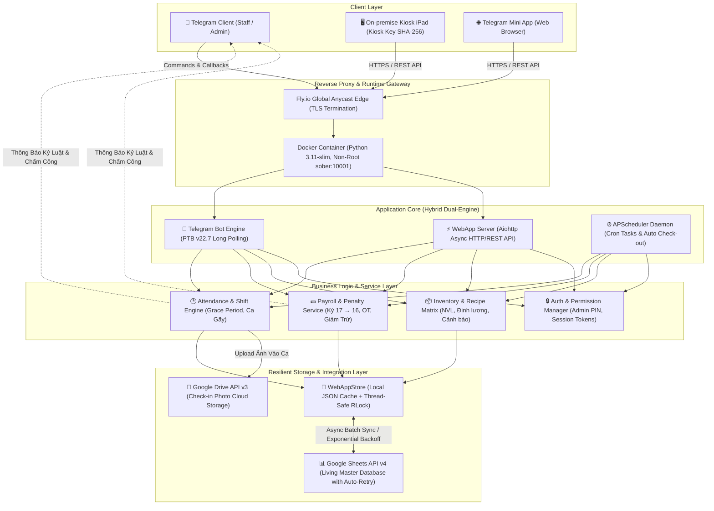

<div align="center">

# ☕ SOBER CAFE — HRM & TELEGRAM MINI APP ECOSYSTEM
### *Enterprise-Grade Operations, Real-Time Attendance & Payroll Automation for FnB*

[](https://github.com/Namnoname101/bot/actions/workflows/fly-deploy.yml)
[](https://github.com/Namnoname101/bot)
[](https://www.python.org/)
[](https://sober-bot.fly.dev)
[](https://telegram.org/)
[](LICENSE)

[🌐 Live Telegram Mini App](https://sober-bot.fly.dev) • [📖 Báo Cáo Thẩm Định Kiến Trúc](docs/superpowers/plans/2026-10-19-architecture-and-codebase-cleanup.md) • [⚡ Kế Hoạch Triển Khai](docs/superpowers/plans/2026-10-20-employee-penalty-system.md)

</div>

---

## 🎯 Executive Summary (Tổng Quan Dự Án)

**Sober Bot** là giải pháp quản trị vận hành F&B toàn diện cho chuỗi quán cà phê, kết hợp liền mạch giữa **Telegram Bot tương tác tức thời** và **Telegram Mini App (Web App)** chạy trên hạ tầng đám mây phân tán Fly.io.

Hệ thống giải quyết trọn vẹn bài toán vận hành thực tế tại điểm bán: từ **điểm danh Kiosk cố định chống gian lận**, **chia ca gãy linh hoạt**, **phê duyệt đi trễ 2 bước**, cho đến **tự động chốt bảng lương thực nhận** và **quản lý hao hụt nguyên vật liệu theo công thức pha chế**.

---

## 🏛️ Sơ Đồ Kiến Trúc Hệ Thống (System Architecture)

Dự án được xây dựng theo mô hình **Dual-Runtime Hybrid Architecture** — chạy đồng thời luồng Long Polling của Telegram Bot và HTTP Server bất đồng bộ (Aiohttp) phục vụ Web App:



---

## ✨ Điểm Nhấn Nghiệp Vụ & Kỹ Thuật (Key Engineering Highlights)

### 1. Điểm Danh Kiosk & Cơ Chế Ca Kíp Linh Hoạt
* **Chống gian lận vị trí:** Xác thực thiết bị cố định tại quán thông qua `SHOP_KIOSK_KEY` sinh từ hàm băm SHA-256 kết hợp giữa Admin Chat ID và Token Bot.
* **Hỗ trợ ca gãy (Split Shift):** Tự động nhận diện ca Sáng (`06:30 - 12:00`), Chiều (`12:00 - 18:00`), Tối (`18:00 - 24:00`) và **Ca Gãy đặc thù (`19:30 - 21:30+`)**.
* **Thời gian ân hạn thông minh (5-minute Grace Period):** Check-in muộn $\le 5$ phút được ghi nhận đúng giờ; quá 5 phút kích hoạt quy trình phê duyệt đi muộn.

### 2. Quy Trình Phê Duyệt Đi Muộn & Trừ Phạt Công Khai
* **Không làm gián đoạn nhân viên:** Khi check-in muộn, nhân viên vẫn nhận thông báo thành công tức thì để vào ca làm việc bình thường.
* **Duyệt 2 bước qua Bot:** Tin nhắn gửi riêng tới Quản lý với 2 lựa chọn:
  * `[ ✅ Đã báo trước (Không trừ) ]`: Ghi nhận lý do chính đáng $\rightarrow$ Không trừ lương.
  * `[ ❌ Chưa báo (Phạt 10k) ]`: Tự động lập biên bản phạt cố định **10.000đ**, gửi thông báo công khai vào Group Chat của quán và tự động trừ vào bảng lương kỳ hiện tại.
* **Trạng thái chờ (Pending):** Nếu quản lý chưa chọn $\rightarrow$ Mặc định không trừ tiền.

### 3. Công Thức Tính Lương Tự Động Theo Chu Kỳ (17 $\rightarrow$ 16)
$$\text{Lương Thực Nhận} = (\text{Tổng Giờ Làm} \times \text{Mức Lương/Giờ}) + \text{Thưởng} - \text{Ứng Lương} - \text{Phạt Kỷ Luật} - \text{Phạt Đi Muộn Chưa Báo}$$
* Tự động tính hệ số giờ làm thêm (Overtime / OT).
* Đồng bộ 2 chiều giữa bảng tính cá nhân (`reward.py`) và Báo cáo Bảng Lương quản trị (`salary.py`).

### 4. Google Sheets làm Database Vận Hành Chống Nghẽn
* Cơ chế **`threading.RLock`** bảo vệ dữ liệu khi nhiều ca làm việc ghi đồng thời.
* Xử lý giới hạn tần suất gọi Google API (Rate Limiting) bằng **Exponential Backoff Retry** (thử lại sau $2^n$ giây).
* Tự động phục hồi cấu trúc Header và định dạng chuẩn khi tạo bảng tính mới.

---

## 🛠️ Công Nghệ Sử Dụng (Tech Stack)

| Hạng mục | Công nghệ / Thư viện | Vai trò & Mục đích sử dụng |
| :--- | :--- | :--- |
| **Backend Core** | `Python 3.11+` | Xử lý nghiệp vụ chính, tính toán bảng lương và concurrency |
| **Telegram Framework** | `python-telegram-bot 22.7` | Telegram Bot tương tác dạng Event-driven, Callback Queries & Job Queue |
| **Web Server** | `aiohttp 3.14` | Máy chủ web bất đồng bộ tốc độ cao phục vụ Telegram Mini App |
| **Data Engine** | `gspread 6.0` + Google Sheets API | Cơ sở dữ liệu vận hành serverless, dễ chỉnh sửa trực tiếp cho chủ quán |
| **Storage Adapter** | `google-api-python-client` | Tải và quản lý ảnh bằng chứng check-in lên Google Drive |
| **Task Scheduling** | `APScheduler 3.11` | Lên lịch nhắc check-in, tự động chốt ca nửa đêm, sao lưu định kỳ |
| **Container & Cloud** | `Docker` + `Fly.io` | Container hóa bảo mật (non-root), triển khai Edge Computing tại Tokyo (`nrt`) |
| **Quality Assurance** | `unittest` (118 tests) + `GitHub Actions` | CI/CD pipeline tự động build, lint và test trước mỗi lần deploy |

---

## 🚀 Hướng Dẫn Cài Đặt & Chạy Local (Quickstart)

### 1. Yêu Cầu Môi Trường
* Python `3.11` hoặc `3.12`
* Tài khoản Telegram Bot (tạo từ `@BotFather`)
* File Google Service Account (`credentials.json`) được cấp quyền vào Spreadsheet của bạn.

### 2. Cài Đặt Nhanh

```bash
# 1. Clone mã nguồn
git clone https://github.com/Namnoname101/bot.git
cd bot

# 2. Tạo môi trường ảo và cài đặt thư viện
python -m venv .venv
source .venv/bin/activate  # Trên Windows: .venv\Scripts\activate
pip install -r requirements.txt

# 3. Thiết lập biến môi trường
cp .env.example .env
```

### 3. Cấu Hình `.env`

Điền các thông số cơ bản vào file `.env`:

```ini
BOT_TOKEN=8080653123:AAE_csT-...
ADMIN_CHAT_ID=123456789
GROUP_CHAT_ID=-1001234567890

SPREADSHEET_ID=your_main_spreadsheet_id
SALARY_SPREADSHEET_ID=your_salary_spreadsheet_id
INVENTORY_SPREADSHEET_ID=your_inventory_spreadsheet_id
DRIVE_FOLDER_ID=your_google_drive_folder_id

GOOGLE_CREDENTIALS_FILE=credentials.json
WEBAPP_ENABLED=true
WEBAPP_PORT=8080
```

### 4. Chạy Ứng Dụng & Kiểm Thử

```bash
# Chạy toàn bộ 118 unit tests
python -m unittest discover tests

# Khởi chạy hệ thống (Bot + WebApp Server)
python main.py
```

---

## 📂 Cấu Trúc Thư Mục Chuẩn Hóa (Project Structure)

```text
├── handlers/                   # Telegram Bot Event Handlers
│   ├── checkin_handler.py      # Xử lý check-in, ca gãy, duyệt đi muộn
│   ├── endshift_handler.py     # Báo cáo doanh thu & chốt ca cuối ngày
│   ├── management_handler.py   # Lệnh Admin, quản lý phạt, phân quyền
│   ├── inventory_handler.py    # Quản lý kho nguyên vật liệu
│   └── reward_handler.py       # Tra cứu lương, quỹ thưởng cá nhân
├── services/                   # Business Services & External Integrations
│   └── sheets/                 # Module Google Sheets Mixins
│       ├── base.py             # Quản lý kết nối, RLock, Exponential Retry
│       ├── attendance.py       # Nghiệp vụ chấm công, trễ ca, ân hạn
│       ├── salary.py           # Công thức tính lương chu kỳ 17 → 16
│       ├── inventory.py        # Xuất/nhập kho và định lượng nguyên liệu
│       └── sync.py             # Đồng bộ lịch sử phạt và dữ liệu web
├── webapp/                     # Telegram Mini App Engine
│   ├── server.py               # REST API endpoints & Static route handlers
│   ├── store.py                # Thread-safe in-memory cache & JSON Store
│   ├── static/                 # Giao diện Mini App (JS, CSS, PWA Assets)
│   └── templates/              # Giao diện HTML Dashboard & Kiosk
├── tests/                      # Bộ kiểm thử tự động toàn diện (118 tests)
│   ├── test_penalties.py       # Kiểm thử hệ thống phạt & giảm trừ lương
│   ├── test_webapp.py          # Kiểm thử REST API, Kiosk auth, Role matrix
│   └── test_sheets_logic.py    # Kiểm thử logic chấm công & tính lương
├── .github/workflows/          # CI/CD Automated Pipelines
│   └── fly-deploy.yml          # GitHub Actions compile, test & auto-deploy
├── Dockerfile                  # Production-ready slim container (CIS Non-root)
├── fly.toml                    # Cấu hình hạ tầng Cloud Fly.io (Tokyo nrt)
└── config.py                   # Quản lý cấu hình & chuẩn hóa RSA Key PEM
```

---

## 🔒 An Toàn & Bảo Mật (Security & Compliance)

* **Zero Hardcoded Secrets:** Tuyệt đối không lưu Bot Token hoặc Service Account Private Key trong Git history; sử dụng Fly Secrets mã hóa đầu-cuối.
* **Non-Root Docker Execution:** Container chạy dưới user `sober` (`uid: 10001`), ngăn chặn rủi ro privilege escalation khi chạy trên hạ tầng container.
* **PEM Key Normalization:** Hệ thống tự động xử lý và chuẩn hóa ký tự xuống dòng (`\n`) của RSA Private Key khi deploy qua nhiều nền tảng Cloud khác nhau.
* **CORS & Domain Whitelist:** API chỉ chấp nhận các request hợp lệ từ Telegram WebApp và địa chỉ IP được cấp phép.

---

## 📄 License & Tác Quyền

Dự án được phát triển và vận hành độc quyền cho chuỗi **Sober Cafe**.  
Mã nguồn mở dưới giấy phép [MIT License](LICENSE).
